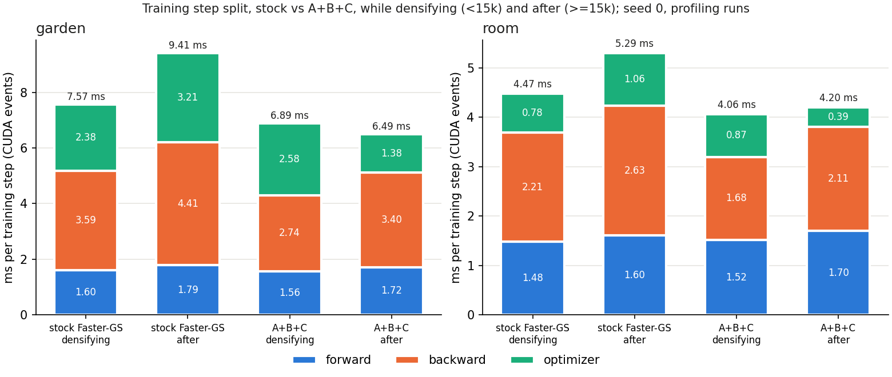

# Where the training step goes: stock vs A+B+C (garden = outdoor, room = indoor)

Phase 2 step 4, jobs 4484137 (garden, node c46) and 4484138 (room, node c104), 2026-10-28, seed 0. Built from [`../build_plus.sbatch`](../build_plus.sbatch) with `STAGES=profile`; analysis by [`../analyze_profile.py`](../analyze_profile.py). The full tables are in [`profile-analysis.md`](profile-analysis.md).

**Method**

- **Step split:** one full 30k profiling run per arm. CUDA events time the three parts of the step: forward (render + loss), backward, and optimizer (step + zero_grad + post-step).
  - Sampling was set to every 250 steps, but the hooks print to stdout, and about half of those lines were lost in the progress-bar output. 25–29 samples per phase survived and are used.
  - The hooks synchronize the host every step, so absolute times are slightly higher than the benchmark's.
  - These 4 runs are in `experiment_log.csv` with role `profile`.
- **Kernels:** two `nsys` captures per arm, 50 steps each: at 5k (densifying, dense Adam in both arms) and at 20k (after A+B+C has switched to selective Adam).
  - Kernels are grouped by name.
  - Kernel time excludes launch gaps, so it is below the step time.
  - The captures (`.nsys-rep`) are on Capella in `~/3dgs-archive/profile/<job>/`. These runs stop after the window, so they have no quality results and are not in the CSV.
- **Scope:** one seed and two scenes. The numbers explain the benchmark; they are not themselves benchmark values.

## Findings

1. **Why the indoor scenes gain less: the optimizer is a much smaller share of room's step.**
   - In stock, the optimizer is 31–34% of garden's step but 17–20% of room's (CUDA events). By kernel time, Adam is 36–38% on garden and 20–22% on room.
   - Room's step is dominated by blending: blend backward is 38% of kernel time and forward blend 12%.
   - So selective Adam (B), which removes optimizer work, has less to remove indoors. A (macro backward) still applies.
   - This is now measured on one indoor and one outdoor scene, seed 0, rather than inferred from scene size.
2. **What A+B+C leaves, after the switch (step 20k, kernel time per step):**

   | | garden | room |
   |---|---|---|
   | blend backward (macro) | 1.30 ms (23%) | 1.16 ms (34%) |
   | preprocess backward | 1.17 ms (20%) | 0.31 ms (9%) |
   | Adam (selective, bf16 SH-rest) | 1.42 ms (25%) | 0.40 ms (11%) |
   | forward (blend + preprocess + sort) | 1.00 ms (17%) | 0.91 ms (26%) |
   | PyTorch ops (loss, fills, copies: 14 small kernels) | 0.59 ms (10%) | 0.35 ms (10%) |
   | total kernel time / step time (CUDA events) | 5.72 / 6.49 ms | 3.45 / 4.20 ms |

   - Outdoors the remaining cost is spread over three similar items: backward blend, backward preprocess and Adam.
   - Indoors, blending (forward + backward) is about half of the kernel time.
3. **Densifying phase (before 15k).**
   - This is where A+B+C spends most of its time now, because selective Adam is off there.
   - On garden, Adam is still the largest kernel group in A+B+C at 5k: 1.90 ms/step (35%), down from 2.40 ms in stock thanks to C.
   - An unexpected result: by CUDA events, the optimizer section does not get cheaper (2.58 ms vs stock 2.38 ms on garden; 0.87 vs 0.78 ms on room). Its kernels do get cheaper, so this section now holds about 0.7 ms per step of time that is not kernel work, probably launch or host overhead in the lean-Adam path (it launches 6 kernels per step).
   - This comparison crosses runs: the events come from the profiling runs and the kernel times from the nsys runs. It needs a direct check (an nsys timeline of the optimizer section) before it is acted on.
4. **Time not covered by kernels.** The A+B+C step time exceeds its kernel time by about 0.75 ms per step on both scenes, which is 12% of garden's step and 18% of room's. Fewer, larger launches or CUDA graphs could recover part of it, and it matters more on the indoor scenes.

## What this suggests for the next levers (in order of expected payoff)

1. **Launch and host overhead:** about 0.75 ms per step on both scenes, plus the optimizer section's anomaly while densifying. Candidates are fusing the six per-parameter Adam launches into one, and capturing the step in a CUDA graph. This helps indoor scenes most, and changes no maths.
2. **Blend kernels:** the macro backward and the forward blend are about half of room's kernel time. Further work on the blend backward, or on the forward blend (7–17%), is the main lever indoors.
3. **Densifying-phase optimizer** (outdoor): an earlier selective switch, or a cheaper dense update before 15k. Selective Adam during densification cost quality before, so this needs quality checks.
4. **Early stop with the 30k schedule kept** (outdoor; see `../stages/README.md`): a separate lever, independent of kernel work.
5. **Preprocess backward** (outdoor, 20% at 20k on garden): grows with the Gaussian count; worth a look after 1–3.
