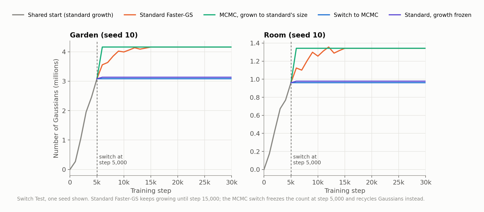
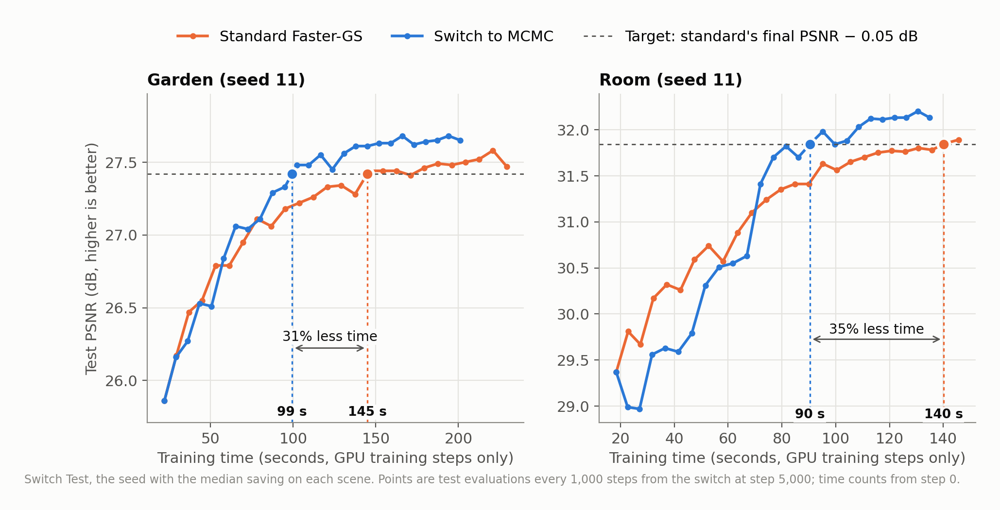
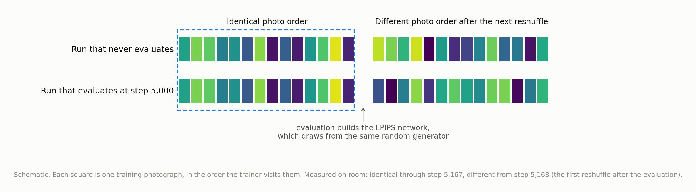
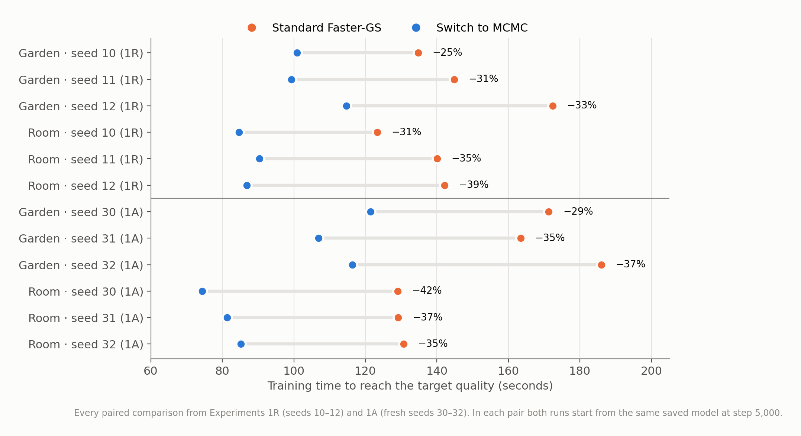
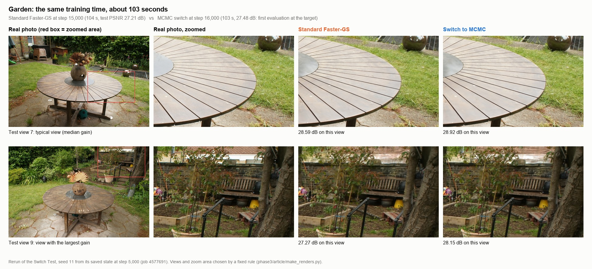
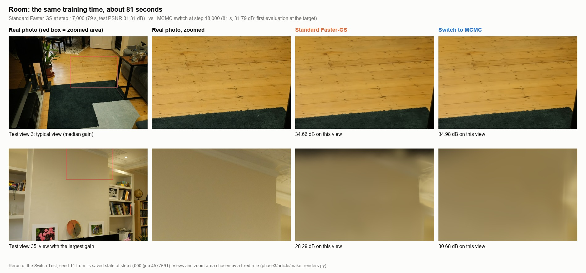
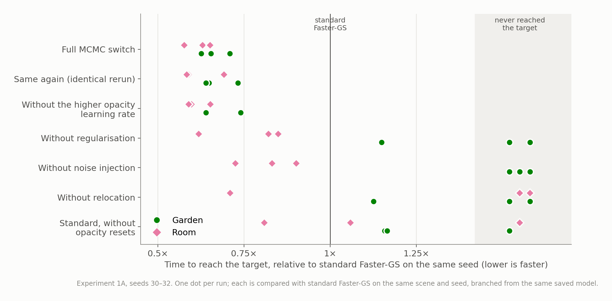
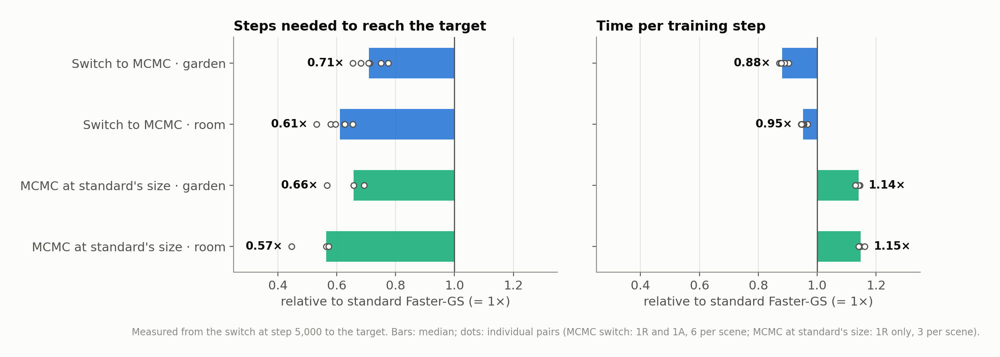

# Same Quality in Fewer Steps: Part 2 of Making 3D Scenes Train Faster

*Switching to a different way of managing Gaussians partway through training cut time-to-quality by about a third on two scenes. Our first attempt at measuring it was invalid.*

In my [previous article](https://asadrizvi64.medium.com/i-asked-an-ai-to-make-3d-scenes-train-faster-heres-what-happened-7201f5ce8bae), I wrote about an experiment where Claude, an AI model working through Claude Code, helped optimize one of the fastest 3D Gaussian Splatting trainers. We made it about 1.45 times faster than the version we started with, across nine scenes, using a collection of GPU optimizations. Then we discovered that Faster-GS's own developers had already improved their code.

That was an interesting lesson about how quickly research moves. But afterward, I started wondering about something else.

All of Part 1 was about making each training step cheaper. I never asked whether the trainer needed all of those steps. So that became the question for Part 2, with the same setup: Claude writing code and running jobs, me choosing what to test, H100 GPUs on TU Dresden's Capella cluster.

## A quick refresher on how 3DGS trains

3D Gaussian Splatting represents a scene as millions of soft, coloured blobs called Gaussians. Each one has a position, a size, an orientation, a colour and an opacity.

Training runs for 30,000 steps. In each step, the trainer picks one of the training photos, renders the scene from that photo's viewpoint, compares the result with the real photo, and nudges the blobs to reduce the difference.

The number of blobs is not fixed. A process called densification adds blobs where the image is still blurry and removes ones that have faded to nearly invisible. In Faster-GS, the count grows to several million.

There is another way to do this. A method called [3DGS-MCMC](https://arxiv.org/abs/2404.09591) (Kheradmand et al., NeurIPS 2024) keeps the number of blobs within a budget. Instead of adding new ones, it uses three tools:

- Relocation moves faded blobs to places that need more detail.
- Noise gives every blob a small random push each step, with bigger pushes for faint blobs.
- Regularisation adds a small penalty on opacity and size.

If you think of blobs as furniture, standard densification keeps buying more pieces when a room looks empty. MCMC rearranges what you already own.

MCMC is not our invention. Its authors already showed it gets better quality with fewer blobs. What I wanted to know was narrower: does it get to a given quality sooner, in training time, inside an already fast trainer?

## The idea: switch partway through

We train normally with Faster-GS up to step 5,000 of 30,000. By then, the garden scene already has about 3 million blobs. At that point we switch to MCMC, which stops adding blobs and starts recycling them.

To make the comparison fair, every version resumes from the same saved model at step 5,000. Whatever happens after that is due to the method, not to a different start.

We compared four versions:

1. Standard Faster-GS, which keeps growing until step 15,000.
2. The switch to MCMC.
3. Standard Faster-GS with growth frozen at step 5,000. This asks whether simply having fewer blobs is enough.
4. MCMC grown to the same size as standard. This asks whether the blob count is what matters.

We used two scenes from the Mip-NeRF 360 dataset: garden (outdoor) and room (indoor).

*All versions share the first 5,000 steps (grey). Standard keeps growing until step 15,000; the MCMC switch stays flat.*

## How we measured it

The metric is time-to-quality. We take standard Faster-GS's final test quality (PSNR, a pixel-level measure of how close the render is to the real photo, in decibels) and subtract 0.05 dB. That is the target. Then we measure how much GPU training-step time each version needs to reach it.

Evaluation time is excluded. Each MCMC run is paired with the standard run from the same saved model and seed.

Before running anything, we wrote down the rules: the metric, the target, and what would make a run invalid. This is called pre-registration, and it mattered more than I expected.

*One seed per scene. On garden, MCMC reaches the target at 99 s against 145 s for standard; on room, 90 s against 140 s.*

## The first attempt was invalid

One of the rules we wrote down was a sanity check. A run that is saved at step 5,000 and then resumed should end up matching a run that was never interrupted, within normal run-to-run noise.

Garden passed. Room did not. The resumed run ended 0.10 dB lower than the uninterrupted one, about twice the 0.057 dB we had allowed.

The first suspect was the save and resume code itself. Claude checked it with SHA-256 fingerprints of the saved model and optimiser state, and everything loaded back exactly. So the problem was somewhere else.

The cause was evaluation. Every time the trainer measured test quality, it rebuilt the LPIPS network, a neural network used to score how similar two images look to a human. Building that network draws numbers from the same random generator that shuffles the order of training photos.

So each evaluation quietly changed which photos the model saw next. On room, the photo order was identical to an uninterrupted run through step 5,167, and different from step 5,168 onward.

*Schematic. Evaluation built the LPIPS network, which used the same random generator as the photo shuffle, so the next shuffle came out differently.*

The fix was to save every random-generator state before each evaluation and restore it afterwards. We also added automatic checks to every run: the photo order must match an uninterrupted run, a resumed run must load exactly the saved state, and evaluation must leave everything unchanged.

This pitfall is known in machine learning, and easy to miss. Without the sanity rule, I would have seen a nice speed-up and moved on.

We kept the first attempt in the records, marked invalid, and reran everything with new seeds. I'll call the rerun the Switch Test. All of its checks passed.

## What the Switch Test showed

With three seeds per scene, the median time saved was 31.4% on garden and 35.5% on room.

The Ingredient Test, described below, repeated both runs with fresh seeds and found 34.6% and 37.0%.

MCMC also ended slightly better. Its final quality minus standard's was +0.19 dB on garden in both experiments, and +0.30 dB and +0.44 dB on room. And it got there with fewer blobs: 3.08 million against 4.17 million on garden, 0.95 million against 1.35 million on room. That is about 27% fewer.

Across all 12 paired comparisons, MCMC reached the target first every time, with savings between 25% and 42%. The result held when we made the target stricter (0.10 dB below standard's final quality) or looser (0.20 dB below), and when we required a run to stay above the target rather than just touch it once.

*Every pair from both experiments. Orange is standard, blue is the MCMC switch. Savings range from 25% to 42%.*

The two control versions told their own stories. Standard with growth frozen at step 5,000 reached the target in only 1 of 6 pairs, and ended slightly worse than full standard (−0.14 dB on garden, −0.09 dB on room). MCMC grown to standard's size was still 21% faster on garden and 30% faster on room, and ended +0.35 dB and +0.51 dB higher.

So fewer blobs alone did not help. MCMC at full size still did.

## What it looks like

To see the difference, we reran one pair per scene (seed 11) from the same saved model with image saving switched on. These reruns land within 0.05 dB of the originals. Each image compares both methods at the same training time.

On garden, at about 103 seconds, standard is at step 15,000 with 27.21 dB and MCMC is at step 16,000 with 27.48 dB. On room, at about 80 seconds, standard is at step 17,000 with 31.31 dB and MCMC is at step 18,000 with 31.79 dB.

A script picked the views and zoom areas by a fixed rule: the view with the median gain, and the view with the largest gain.

*Garden at about 103 seconds of training. Top: a typical view. Bottom: the view with the largest gain.*

*Room at about 80 seconds of training. Top: a typical view. Bottom: view 35, where standard still shows dark smudges on the wall.*

In the typical views, the two methods differ by about 0.3 dB, and I can't really tell them apart by eye.

The one big visible difference is room view 35: standard scores 28.29 dB with dark smudges on the wall, MCMC scores 30.68 dB. But room views 34 to 36 are also the least stable between identical runs. So treat it as a best case, not a typical frame.

## The Ingredient Test: which parts matter?

MCMC is a bundle of changes. The Ingredient Test removes one at a time, on both scenes, with three fresh seeds.

The ingredients were relocation, noise, regularisation, and a doubled opacity learning rate (0.05 instead of the default 0.025, which Faster-GS recommends for MCMC).

We also added two reference runs. One was an exact repeat of the full MCMC run, to show how much GPU noise alone moves the results. The other was standard Faster-GS without opacity resets. While it is growing, standard training resets every blob's opacity to near zero every 3,000 steps, and MCMC doesn't.

*Each dot is one run compared with standard on the same scene and seed. The grey band on the right means that run never reached the target.*

Without relocation, 4 of 6 runs never reached the target, and the runs ended 0.34 dB (garden) and 0.73 dB (room) lower than full MCMC. This was the clearest result.

Without noise, 3 of 6 runs never reached the target, all of them on garden. On room, the runs got there, but later.

Without regularisation, 2 of 6 runs never reached the target. At the stricter targets it was clearly needed. At the loosest target (0.20 dB below) the picture was not clear.

Without the doubled learning rate, MCMC was about as fast. So it isn't needed for speed. It did cost a little image quality on garden: LPIPS was 0.0019 worse, just under the 0.002 limit we had set.

Standard without opacity resets was not faster, and it ended with more blobs (5.1 million against 4.2 million on garden). So the resets are not what slows standard down.

One caution. These ingredients interact. In an early test, removing noise cut the number of relocations about sixfold. Leave-one-out tells you which ingredient is necessary given the others. It doesn't tell you how to split the credit between them.

## Fewer blobs, or a better process?

The obvious explanation for the speed-up is that MCMC has about a quarter fewer blobs, so each step should be cheaper. We could check that without any extra GPU time, by splitting the existing logs:

time = steps × time per step

The result surprised me. After the switch, MCMC needed 29–40% fewer steps to reach the target. But each step was only 5–12% cheaper, even with about a quarter fewer blobs.

Fewer steps accounted for about 72% of the saving on garden and 92% on room. That split was consistent across all 12 pairs.

The MCMC version grown to standard's size makes the point more directly. Its blob count was within 3% of standard's. Each of its steps was about 15% slower, yet after the switch it needed 34–43% fewer of them, and it was still faster in every pair.

*Left: steps needed after the switch to reach the target. Right: time per training step. Both relative to standard Faster-GS (1×). MCMC at standard's size takes slower steps but far fewer of them.*

On these two scenes, then, MCMC is not fast because it is small. The way it manages blobs makes the model learn in fewer steps. Frozen growth fits the same picture: a small model without MCMC's process does not get the saving.

What we don't know is which mechanism inside MCMC makes the steps go further.

## Checking the clock

Some work happens between training steps: densification, relocation, reordering blobs in memory, opacity resets. Our timer didn't cover it, so in the Ingredient Test we measured it. It came to under 1% of training time, and it was larger for standard (about 1.7 seconds on garden) than for MCMC (about 0.3 seconds). Counting it would help MCMC slightly.

To be clear, the 25–42% figures are training time to reach a set quality, not total run time.

## Is any of this new?

Claude did two passes through the literature, including every paper that cites the MCMC paper.

MCMC's better final quality is widely known, and we reproduced it. That it reaches quality sooner has been claimed, mostly from single runs at very different blob counts, so our paired, multi-seed result is stronger evidence.

We didn't find anyone switching to MCMC partway through, though it's a small step. Nor did we find relocation measured as necessary, or a speed-up traced to fewer steps at equal blob count. Evaluation changing training through shared randomness is known in general.

One thing we found nowhere: the exact repeat of a full MCMC run ended within about 0.05 dB of the original on average, yet on one room test photo it scored 8.1 dB below the other runs of that seed.

So this is not a new algorithm. It's a careful measurement, plus an answer, on two scenes, to why MCMC is faster.

## The experiment we didn't run

Next we drafted a nine-scene study: 9 scenes, 3 seeds, 5 versions, 189 runs, about 50 GPU-hours.

An outside review advised against running it, and I agreed. It would mostly confirm known results. Its key analysis, splitting steps from cost per step, could be done from existing data, so we did that instead. One comparison was unfair: it timed MCMC-from-the-start only after step 5,000. And even a perfect result would study someone else's method.

The draft is still in the repo, marked as shelved.

## What I took from this

Part 1 made each step cheaper. Part 2 found a way to need fewer steps, and on these two scenes that turned out to be where most of the gain was.

The most useful thing we did was write the rules down before running anything. The first attempt produced a good-looking result, and it was invalid. The rule we had committed to is what made us dig until we found the evaluation bug.

Smaller isn't automatically faster. A quarter fewer blobs bought only 5–12% cheaper steps, and freezing growth without MCMC's process made things worse.

The boring checks were worth it: GPU noise, what the timer actually covers, and whether evaluation is neutral. None of them changed the conclusions. But I only know that because we checked.

At some point more experiments stop teaching you new things. That's where I think we are, so I'm writing it up.

## Credits

Claude, working in Claude Code, wrote the code, ran the cluster jobs, did the analysis and made the figures. I chose the questions, decided which experiments to run and which to drop, and brought in the outside reviews.

This work builds on [Faster-GS](https://arxiv.org/abs/2602.09999) (Hahlbohm et al., CVPR 2026) and [3DGS-MCMC](https://arxiv.org/abs/2404.09591) (Kheradmand et al., NeurIPS 2024). Everything is in the [repo](https://github.com/asadrizvi64/3dgs-project) under `phase3/`, where the Switch Test and the Ingredient Test are filed as Experiment 1R and Experiment 1A. The figures come from `phase3/article/make_figures.py` and `make_renders.py`.

## Glossary

- Gaussian (blob): one soft, coloured ellipsoid. A scene is made of millions of them.
- Densification: adding blobs where the image is blurry and removing faded ones.
- MCMC (3DGS-MCMC): a method that keeps a fixed budget of blobs and moves them around instead of adding new ones.
- Relocation: moving faded blobs to where more detail is needed.
- PSNR: peak signal-to-noise ratio, a pixel-level measure of image similarity in decibels (dB). Higher is better.
- LPIPS: a perceptual similarity score computed by a neural network. Lower is better.
- Seed: the starting number for a random generator. Same seed, same random choices.
- Pre-registration: writing down the metric and decision rules before running the experiment.
- Time-to-quality: GPU training time needed to reach a fixed quality target.
